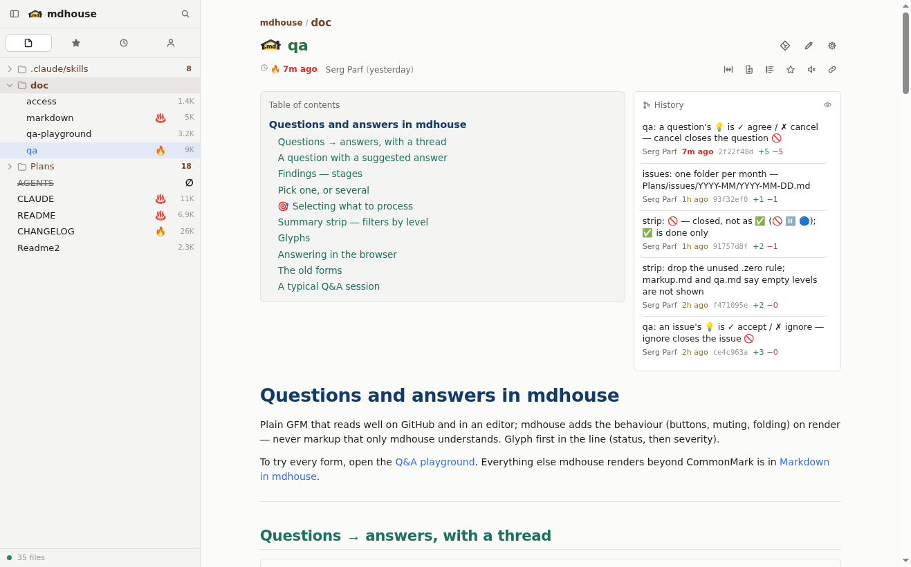
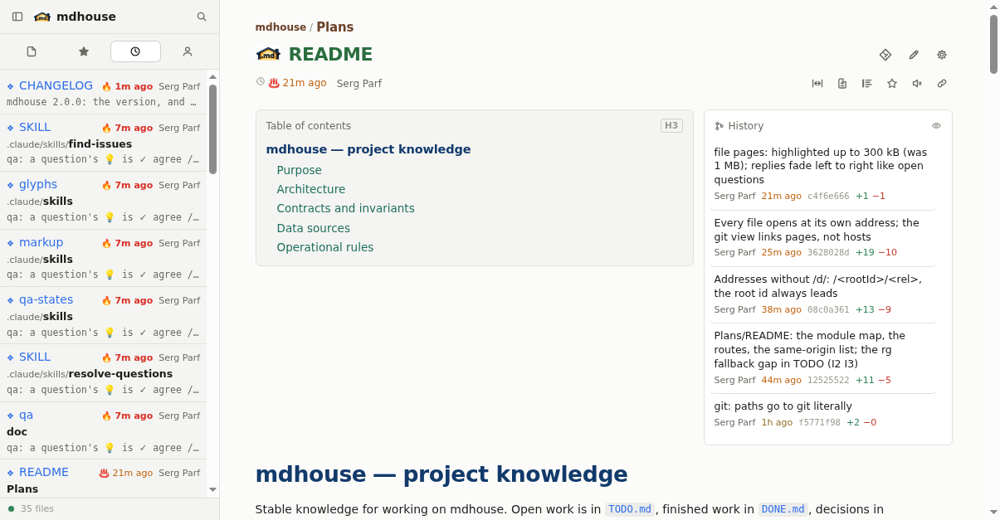
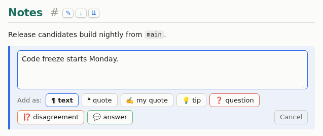
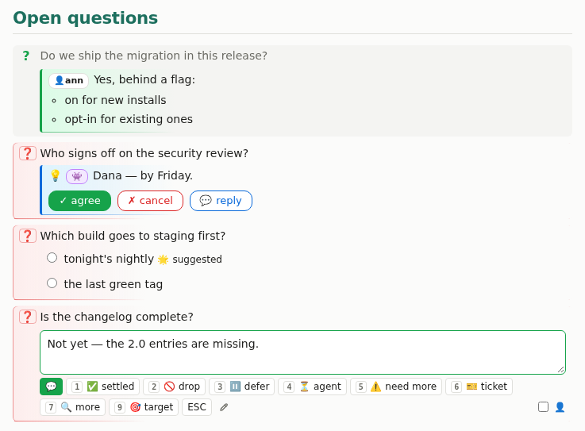

<p align="center">
  
</p>

# ❖ mdhouse

**A Markdown workspace on your own machine — read every file, answer questions, triage issues and commit, together with your AI agents.**

**TL;DR** — [mdhouse in short](Readme2.md)

> ✦ **In ten seconds.** Point it at a folder — notes, a repo, a pile of repos — and get one
> browser tab with a file tree, instant search, and a live *what changed lately* view fed by
> git. Questions and issues your agent writes into a `.md` file become buttons on the page; your
> answers go back into the file. Nothing is imported, indexed or copied anywhere, and it never
> writes to a folder unless you say `--rw`.

```bash
mdhouse ~/notes
```



For people who read and write a lot of Markdown — and work with agents that write it too — and
are tired of `cat`, `less`, and editor previews that show one file at a time.

---

## ▸ Install

```bash
bun install -g mdhouse      #  bun 1.4+ required
```

## ▸ Start

```bash
mdhouse ~/notes ~/src -p     # serve folders, -p = save them for every later start, start in background
mdhouse service install      # starts now and at every login, serving the saved folders
```

- Open <http://127.0.0.1:7777>
- `mdhouse --rw <folder>` - add new folder and allow to [edit and answer on the page](#-working-on-docs--with-you-and-your-agents)
- More in [Running it](#-running-it)

---

## ❖ What you get

- ⚡ **Live filesystem updates via WebSocket instead of polling** — a file changes, the page changes. No reload button.
- 🔥 ♨️ **Freshness indicators** — 🔥 changed in the last 10 minutes, ♨️ in the last hour, then fades to grey.
- 🌿 **Git integration** — who changed what and when, what is new since yesterday. Commit with one button.
- ⊟ **Markdown diffs** — what changed is marked right on the page: added in green, removed in red, as easy to read as the doc itself.
- 🖋 **Many standards supported** — tables, checklists, diagrams, colored code, pictures, PDFs, video — [more](doc/markdown.md)
- 📁 **All your files in one place** — every folder, every repo, one tree on the left.
- 🔍 **Find anything** — type a word, jump to the exact line.
- 🕐 **Recent and Mine** — what changed lately, and what *you* changed.



- 🔒 **Safe** — nothing is copied or uploaded; it only reads, unless you allow writing.
- 🌙 Light and dark, on a phone too.

---

## ✎ Working on docs — with you and your agents

Writes need a folder served with `--rw`: `mdhouse -p --rw folder(s)`. The markup is plain GFM —
[Questions and answers](doc/qa.md); try every form on the [Q&A playground](doc/qa-playground.md). Every syntax on one page: [Syntax](doc/syntax.md). For your agents: [Markup for agents](doc/agent-markup.md) — give it and say "do like this".

**Edit while reading**

- ☑️ Tick a checkbox — that one line is saved
- Hover a heading: ↓ add a block right under it · ⇊ at the end of its section — as text, quote,
  my quote, tip, question, disagreement or answer; Ctrl+Enter — the last one used, my quote at first
- ✎ / `e` / Alt+E — open the file at that line in your editor (`edit:/path:line`)



**Answer an agent's questions**

- `/ask-questions` writes `- ❓ …` items — with a `💡` proposal or `( )` / `[ ]` options
- You click the ❓ (or the item), write, **💬** — Ctrl+Enter; Ctrl+Shift+Enter saves and opens the next one. On a 💡: ✓ agree / ✗ cancel. A click picks an option. ⚠️ need more, 🔍 more (Alt+1…9)
- `/resolve-questions` carries the answers into `DECISIONS.md` / `TODO.md` and marks them ✅



**Review and fix with an agent**

- `/find-issues` writes issues to `Plans/issues/YYYY-MM/YYYY-MM-DD.md` — 🔴 🟠 ⚪, an id (`B44`),
  Evidence, Impact, a 💡 fix
- You triage on the page: ✓ accept / ✗ ignore, or a stage — ✅ 🚫 ⏸️ ⏳ ⚠️ 🎫; 🎯 selects what to
  do next; the strip `N │ 🔴 🟠 ⚪ ✅ 🚫 🎯` counts and filters
- `/fix-issues` does the accepted and 🎯 ones, checks each first, records ✅ and the commit in place

**Ask the agent**

- Add your own `- ❓` or `⁉️` (↓ ⇊ → question), set ⏳ agent or 🎯 — the agent replies `💬👾` / `💡👾`
- 🗨 / `a` — Agent Bus (`mdhouse --agent-bus`): tell a running AI session the page changed, see its answer — [Agent Bus integration](doc/agent-bus.md)

**Commit from the page**

- The git view: Commit (Markdown; any other file only once ticked), Pull, Push
- A document's uncommitted changes: **Reset file** — back to the last commit, after a confirm

🛡 Each write changes only its own lines; if the file changed meanwhile it is refused and your
text is kept

---

## 👾 Agent skills

- Ask your AI: *use https://github.com/parf/mdhouse/blob/main/doc/agent-markup.md and do a review*
- Or ask Claude: *copy skills from [mdhouse](https://github.com/parf/mdhouse)* — we are pretty sure
  our review skills will trump yours :)

---

## 🗨 Agent Bus

- Talk to an agent of your choice or a specific one associated with a page
- `a` opens AI agent chat panel on the right (like in VSCode/Antigravity)
- Answers come back into the panel; each page keeps its last 20
- [Agent Bus integration](doc/agent-bus.md)

---

## 🔒 Read-only unless you say, and local

- 📖 **Read-only by default.** Write access - cli only `mdhouse -p --rw dir` (-p = save)
- ✏️ **Small, checked writes** — a tick, an answer, a block under a heading, a commit
- 🏠 **Local.** Binds `127.0.0.1` unless you pass `--host`; users and allowed networks — [Access](doc/access.md)
- ⚙ Your settings live in `~/.config/mdhouse/`, never inside a served folder

---

## ⌨ Keyboard

| Keys | |
| --- | --- |
| `Ctrl+B` / `⌘B` | cycle the sidebar: bar → compact → open |
| `/`, `Ctrl+K`, `Ctrl+P` | open the sidebar and focus search |
| `?` | version, links and this list |
| `Esc` | clear the search query, or close the dialog |
| `e` | open the document in your editor |
| `Ctrl+Enter` | in a form: save |
| `Ctrl+Shift+Enter` | in an answer form: save, open the next open question |
| `Alt+1`…`Alt+9` | in an answer form: the action with that number |
| `Alt+E` | in a form: open the file at that line in your editor |

## ▸ Running it

```bash
mdhouse                          # serve the saved folders
mdhouse ~/src                    # add a folder to the running one — never a second server
mdhouse ~/notes -p --port 8080   # save folders, and the port / host, for every later start
mdhouse --rm ~/notes             # forget a folder and stop serving it
mdhouse exit                     # stop it (--all: every port)
mdhouse service install          # systemd: now and at every login; also status, uninstall
```

Log: `journalctl -t mdhouse -f` · Config: `~/.config/mdhouse/prefs.json`

---

## ▸ Options

| Flag | |
| --- | --- |
| `-p, --perm` | save the folders, and any `--port` / `--host` given, for every later start |
| `--rw <folder(s)>` | allow editing |
| `--rm <folder(s)>` | forget the folders and stop serving them |
| `--auto-rw <path,…>` | every folder served from under these is writable |
| `--host-name <name,…>` | behind a reverse proxy: only these names get in, not localhost or IPs — [access](doc/access.md#behind-a-reverse-proxy) |
| `--host <addr>` | address to bind — default `127.0.0.1`; `0.0.0.0` to share on your LAN |
| `--port <n>` | default 7777 |
| `--fg` | stay in the foreground |

`mdhouse --help` lists the rest. A root may carry a **`.mdhouseignore`**: one directory name per
line, `#` for comments, `!name` to bring back a directory the built-in deny list hides
(`node_modules`, `vendor`, build output and the like)

---

## ▸ Development

Run it from a clone:

```bash
git clone https://github.com/parf/mdhouse
cd mdhouse
bun install
sudo ln -sfn "$PWD/bin/mdhouse" /usr/local/bin/mdhouse    # put on your PATH
mdhouse dir  # run it
```

Want to debug:

```bash
bun run dev          # this repo on :7790, its own config (.scratch/), foreground; restart after a UI edit
bun test
bunx tsc --noEmit
```

What changed in each release: [`CHANGELOG.md`](CHANGELOG.md)

Licensed under the **GNU General Public License v2** — see [`LICENSE`](LICENSE)
