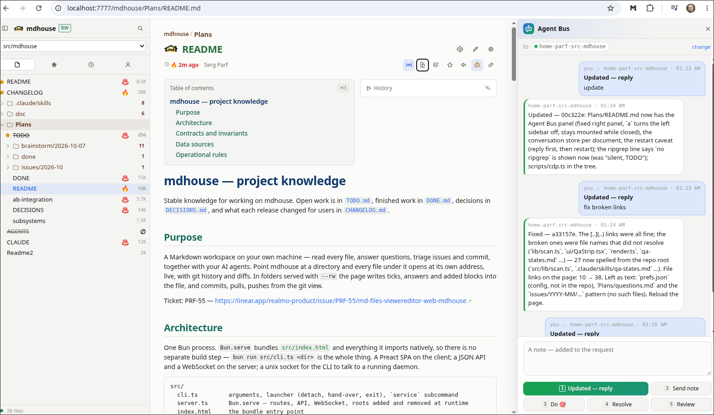

# Agent Bus — AI agent chat panel

**Main idea — AI agent chat about the current page.** History preserved!



## The idea

- 💬 Chat with an AI agent about the page you are on — it reads the same file
- 💾 History preserved — every page keeps its own chat
- 📄 The document is the shared workspace; the chat only points an agent at it
- 🔁 The agent edits the file → the page follows live → you answer on the page → "updated" hands it back
- 🎯 One click asks for the usual next step: re-read, do the 🎯 items, carry answers over, review
- 📌 A page can belong to an agent — it writes its bus name into the file
  (`<!-- AB: #claude/x@host -->`); else you pick, or the default one answers
- 🤝 Nothing new for the agent: a plain message on [Agent Bus](https://github.com/parf/ai-agent-bus);
  it replies as to any peer

## Turn it on

```sh
mdhouse --agent-bus          # off: mdhouse --agent-bus off
```

Settings → Agent Bus: the default agents, which names to list.
