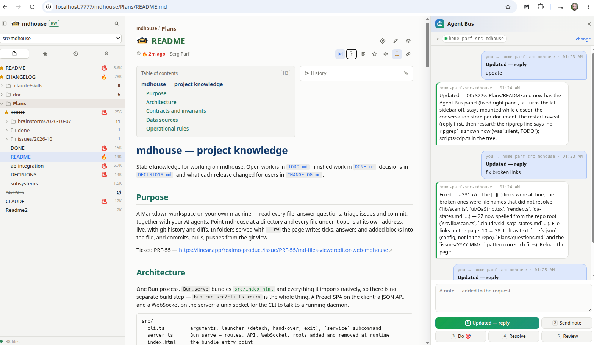

# Agent Bus — AI agent chat panel

**Main idea — AI agent chat about the current page.** History preserved!

Runs on [Agent Bus](https://github.com/parf/ai-agent-bus) — https://github.com/parf/ai-agent-bus



## The idea

- 💬 Chat with an AI agent about the page you are on — it reads the same file
- 💾 History preserved — every page keeps its own chat
- 📄 The document is the shared workspace; the chat only points an agent at it
- 🔁 The agent edits the file → the page follows live → you answer on the page → "updated" hands it back
- 🎯 One click asks for the usual next step: re-read, do the 🎯 items, carry answers over, review
- 🎙 The note accepts browser voice input: click the microphone or press `Ctrl+Shift+Space` to
  start and accept; `Esc` cancels without changing the note
- 📌 A page can belong to an agent — it writes its bus name into the file
  (`<!-- AB: #claude/x@host -->`); else you pick, or the default one answers
- 🤝 Nothing new for the agent: a plain message on [Agent Bus](https://github.com/parf/ai-agent-bus);
  it replies as to any peer

## Turn it on

A new mdhouse turns it on by itself while your Agent Bus is installed: `auto` is on while the login's
account socket (`$XDG_RUNTIME_DIR/agent-bus/user-<login>.sock`, else `/run/agent-bus/user-<login>.sock`) exists, and is looked at again
on every request. A config that already exists keeps what it says. Otherwise:

```sh
mdhouse --agent-bus          # on; off: mdhouse --agent-bus off; back to automatic: mdhouse --agent-bus auto
```

The start line says which:

- `agent-bus: on — <socket> (found)` — on; `(found; auto)` when automatic
- `agent-bus: auto — not installed (no <path>)` — automatic, nothing to connect to
- `agent-bus: off — found <socket>: mdhouse --agent-bus on` — off by your choice, while the socket is there

Settings → Agent Bus: the default agents, which names to list.

## Open a page from an agent

An agent sends `#mdhouse@<host>` a JSON request on topic `mdhouse.ctl`; `ask help` lists the ops.

```json
{"v":1, "op":"inventory", "requestId":"i1"}
{"v":1, "op":"open", "requestId":"o1", "rootId":"notes", "path":"plans/a.md", "clientId":"…"}
```

- `inventory` → projects (`rootId`, name) and open browser tabs (`clientId`, browser · title, page)
- `open` → `{url, opened}`: that one tab goes to the document; no other tab moves
- `opened: false` + `reason`: `gone` (tab closed), `busy` (unsaved editor text), `team` (users configured)
- Reads only: no writes, settings, projects or users; the path stays inside its project, Markdown only
- The same `requestId` again → the first reply, the tab is not moved twice
- Each request → a line in the log and in mdhouse's agent log
- One mdhouse per host serves it (a bus lock); another one logs *served by another mdhouse*

Who may send — the agents and people the `#mdhouse` record's bus ACL admits; narrow it further or turn it off:

```sh
mdhouse --ab-control 'claude/.*,codex/w1'   # whole names without #, regexes
mdhouse --ab-control off                    # nobody
mdhouse --ab-control reset                  # every agent the daemon admits
```

## Scheduled runs

A project's `.mdhouse/automation/<id>.json` names an analysis flow and a timer. It fires on this machine only after its administrator approves the file:

- Approve → a bus schedule on `#mdhouse@<host>` (topic `schedule`); the approval keeps the file's content hash
- A changed file (a pull, a commit) stops firing until approved again; revoke deletes the schedule
- A firing writes a run document under `Plans/flows/runs/<flow>/`
- Approvals and the run history live in the bus KV of `#mdhouse@<host>` — per host, not in the project

## Remote Agent Bus

Over TCP, with a token:

```sh
mdhouse --agent-bus http://host:6767     # asks for the token, or reads it from stdin
```

- The token is saved in `~/.config/mdhouse/prefs.json` (0600), never in argv; `--agent-bus <x.sock>` drops it
- Not `AGENT_BUS_TOKEN`: in an AI session's shell that is the session's own — mdhouse would act as it

Or forward the remote socket over ssh — no token:

```sh
ssh -N -o StreamLocalBindUnlink=yes \
    -L /tmp/ab-rdvp.sock:/run/agent-bus/user-<login>.sock rdvp &
mdhouse --agent-bus /tmp/ab-rdvp.sock
```

- You join as your login on that host — sshd runs as you; no token
- The remote agents read the project file path mdhouse sends — the same project directory must be there (a shared mount, the same checkout)
- The tunnel is down → settings say *not connected*
